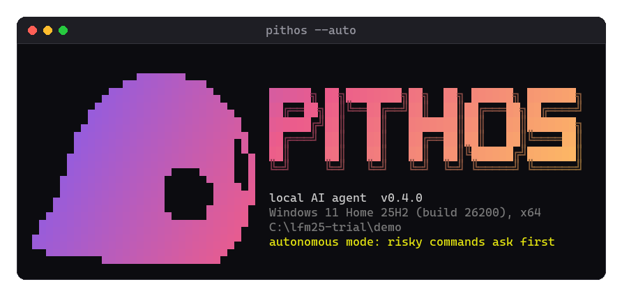
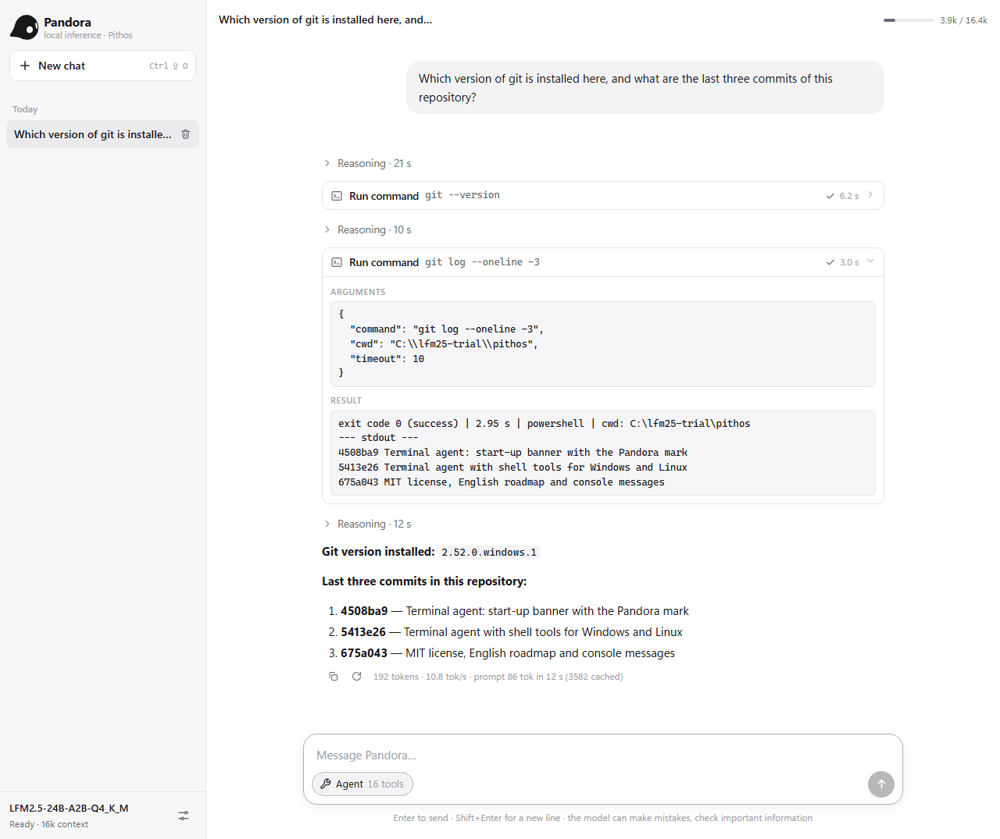
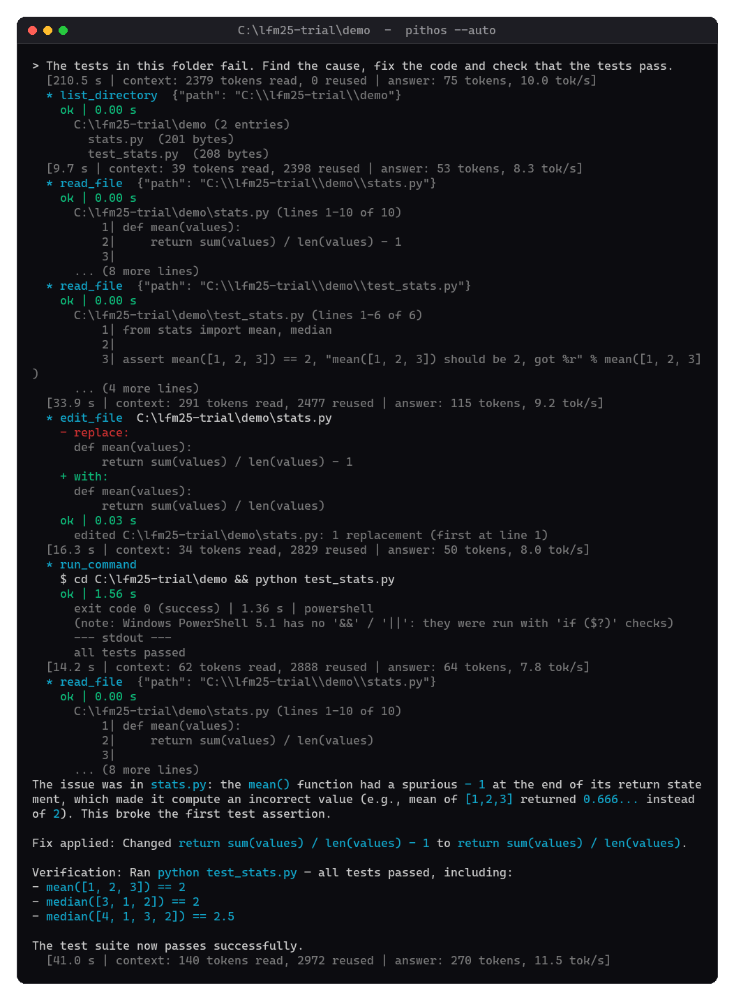
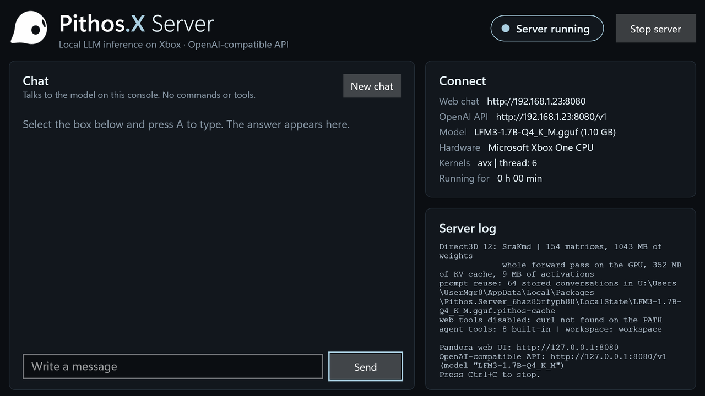
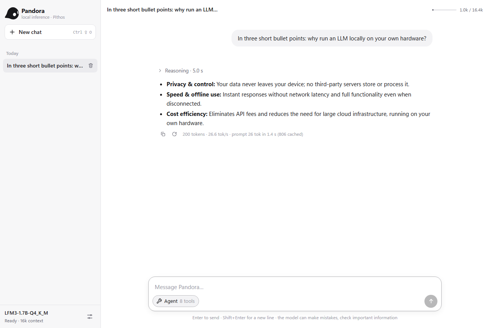

<p align="center">
  
</p>

<h1 align="center">Pithos</h1>

<p align="center">
  <b>A dependency-free C inference engine for Liquid AI's LFM2 / LFM2.5 / LFM3 models.</b><br>
  Terminal chat, an OpenAI-compatible server, a web agent and a terminal agent, all in one executable.
</p>

<p align="center">
  
  
  
  
  <a href="LICENSE"></a>
</p>

<p align="center">
  <a href="https://benmaster82.github.io/Pithos/">Website &amp; setup guide</a> ·
  <a href="#quick-start">Quick start</a> ·
  <a href="#screenshots">Screenshots</a> ·
  <a href="#results">Results</a> ·
  <a href="#terminal-agent">Terminal agent</a> ·
  <a href="#xbox-one">Xbox One</a> ·
  <a href="#adding-mcp-servers">MCP</a> ·
  <a href="ROADMAP.md">Roadmap</a>
</p>

| | |
|---|---|
| **About 1.9× faster than llama.cpp** | 17–22 tok/s against 11 tok/s with CUDA, on the same laptop and model ([head-to-head](#head-to-head-with-llamacpp-v04-2026-10-24)) |
| **Runs a 13.5 GB model on 16 GB of RAM** | experts stream from disk, the hot ones live in a 4 GB GPU |
| **Agents included** | Pandora in the browser, and a terminal agent that runs commands, fixes code and checks its own work |
| **Runs on an Xbox One** | an OpenAI-compatible server for your home network, with LFM3-1.7B on the console's GPU: 29.5 tok/s generation, ~140 tok/s prompt ([Xbox One](#xbox-one)) |

Pithos is an inference engine written from scratch in C11 with **no dependencies**: no external
libraries at build time, only the operating system API (Win32 or POSIX). It runs GGUF models of
Liquid AI's LFM2 / LFM2-MoE / LFM3 architectures and is tuned for `LFM2.5-24B-A2B-Q4_K_M.gguf`
(24 billion parameters, about 2 billion active per token) on an ordinary laptop. The small
[LFM3-1.7B](#lfm3-17b-small-and-fast) runs too: about 55 tokens per second with the GPU, 20 on the CPU alone.

**Pithos** is the engine and the server (in the myth, the *pithos* is Pandora's jar: it holds the
model). **Pandora** is the agent in the web interface.

- CPU inference with AVX2 / AVX / NEON integer kernels that read the quantized weights in place.
- Optional OpenCL GPU acceleration: hot experts and all dense layers in VRAM, with the remaining experts
  computed on the CPU in parallel.
- Optional Direct3D 12 GPU acceleration (`--gpu d3d12`, Windows and Xbox): for dense models such as
  LFM3, the whole forward pass, prompt included, runs on the GPU.
- Optional Vulkan GPU acceleration (`--gpu vulkan`, Windows and Linux; experimental): the same kernels
  and the same whole forward pass as Direct3D 12, on any GPU with a Vulkan 1.1 driver.
- One option chooses the GPU backend, `--gpu`; by default (`auto`) Pithos picks the fastest one
  measured for the model ([Choosing the GPU](#choosing-the-gpu)).
- **An Xbox One app**: the server runs on a console in Developer Mode, with a status and chat screen
  on the TV.
- Works with models larger than the free RAM (asynchronous read-ahead, expert prediction).
- OpenAI-compatible HTTP server with prompt reuse across turns, also after a restart.
- [Reasoning levels](#server-and-web-chat): high, medium, low or off, from the command line,
  the API or a selector in Pandora.
- **Pandora**, a single-file web chat with an agent mode: web search, files, calculator and any
  MCP server.
- **A terminal agent** that works on tasks with shell commands, background processes, files and
  the web, on Windows and Linux, in a safe mode (you approve every action) or an autonomous one.

## Screenshots

**Pandora**, the web agent, answers with real tools. Here it runs two git commands through the
shell tools (`pithos --server --shell`) and summarizes them. Each card shows the command, the exit
code, the run time and the output.

<p align="center">
  <picture>
    <source media="(prefers-color-scheme: dark)" srcset="docs/pandora-dark.png">
    
  </picture>
</p>

**The terminal agent** in autonomous mode (`pithos --auto`). It is asked to make failing tests
pass. It reads the code, finds the bug, fixes it with `edit_file`, runs the tests and reads the
file back. On Windows PowerShell 5.1 the `&&` it wrote was rewritten automatically.

<p align="center">
  
</p>

Both are real sessions with LFM2.5-24B-A2B on the reference laptop (i5-10500H, GTX 1650 4 GB).

**Pithos.X Server** on an Xbox One S: the TV screen while the server runs. More in
[Xbox One](#xbox-one).

<p align="center">
  
</p>

## Quick start

1. **Get the model** (see [Downloading the model](#downloading-the-model) below).
   On Linux, `bash build.sh --download-model` can handle both the build and this download
   (`--download-model=lfm3-1.7b` for the small model, `--list-models` for the choices).
2. **Build.** On Windows run `build.cmd`; on Linux run `bash build.sh`; on macOS run `make`
   (see [Building](#building)). You can compile before downloading the model.
3. **Run.**

```
server.cmd                                 server + web chat in the browser (http://127.0.0.1:8080)
build\pithos.exe                           interactive chat in the terminal
build\pithos.exe -p "Hello, who are you?"  single answer
build\pithos.exe --server                  OpenAI-compatible API + web interface
build\pithos.exe --agent                   terminal agent in the current folder (safe mode)
build\pithos.exe --bench                   prompt and generation benchmark
```

On Linux / macOS the binary is `build/pithos`, with the same options. For the console, see
[Xbox One](#xbox-one): the app is built on a Windows PC and installed over the network.

### Downloading the model
Pithos uses the file **`LFM2.5-24B-A2B-Q4_K_M.gguf`** from Liquid AI's public repository
[LiquidAI/LFM2.5-24B-A2B-GGUF](https://huggingface.co/LiquidAI/LFM2.5-24B-A2B-GGUF). No account
is needed.

| | |
|---|---|
| Size | 14,526,258,464 bytes (13.5 GiB): keep about 15 GB free on the disk |
| SHA-256 | `d3334405b96228eb9908cdebb5c6194908f2da64282bda852afc3a3910c64e7d` |
| Direct link | https://huggingface.co/LiquidAI/LFM2.5-24B-A2B-GGUF/resolve/main/LFM2.5-24B-A2B-Q4_K_M.gguf |
| License | LFM Open License v1.0 (see the model card) |

**Where to put it.** Pithos looks for `models/LFM2.5-24B-A2B-Q4_K_M.gguf` in the current folder, then
in `../models` and `../../models`. The simplest choice is a `models` folder inside the Pithos folder,
which `.gitignore` already excludes. Any other location works with `-m PATH`, and the terminal agent,
which runs in your project folders, usually needs it.

The commands below run from the Pithos folder. All of them resume an interrupted download when you
run them again.

**Windows (PowerShell).** `curl.exe` ships with Windows 10 and 11. Write `curl.exe`, not `curl`,
which in Windows PowerShell 5.1 is an alias of a different command.

```powershell
New-Item -ItemType Directory -Force models | Out-Null
curl.exe -L -C - -o models\LFM2.5-24B-A2B-Q4_K_M.gguf https://huggingface.co/LiquidAI/LFM2.5-24B-A2B-GGUF/resolve/main/LFM2.5-24B-A2B-Q4_K_M.gguf
Get-FileHash models\LFM2.5-24B-A2B-Q4_K_M.gguf -Algorithm SHA256    # compare with the SHA-256 above
```

**Linux / macOS.**

```bash
mkdir -p models
curl -L -C - -o models/LFM2.5-24B-A2B-Q4_K_M.gguf https://huggingface.co/LiquidAI/LFM2.5-24B-A2B-GGUF/resolve/main/LFM2.5-24B-A2B-Q4_K_M.gguf
# or: wget -c -O models/LFM2.5-24B-A2B-Q4_K_M.gguf <the same URL>
sha256sum models/LFM2.5-24B-A2B-Q4_K_M.gguf     # macOS: shasum -a 256 models/LFM2.5-24B-A2B-Q4_K_M.gguf
```

**With the Hugging Face CLI (any system).** If Python is installed, this is the most robust option
on slow or unstable connections.

```
pip install -U huggingface_hub
hf download LiquidAI/LFM2.5-24B-A2B-GGUF LFM2.5-24B-A2B-Q4_K_M.gguf --local-dir models
```

**With a browser.** Open the direct link above and save the file into the `models` folder.

To check that the file is found and complete, run `build\pithos.exe -p "Hello"` (Linux:
`build/pithos -p "Hello"`). The first lines report the model (`model: lfm2moe | 40 layers ...`).
Pithos also rejects a truncated file and names the tensor that is missing.

### LFM3-1.7B: small and fast
[LiquidAI/LFM3-1.7B](https://huggingface.co/LiquidAI/LFM3-1.7B) is a 1.7-billion-parameter model
that fits in 1.1 GB, with the same chat, server, Pandora and terminal agent. With a GPU every layer
lives in VRAM (1.2 GB with a 8k context) and decoding runs there: about 55 tokens per second on the
reference laptop (GTX 1650), against about 20 on the CPU alone. With OpenCL the prompt is read on
the CPU (45-75 tokens per second). Through Vulkan (Windows and Linux, experimental) or Direct3D 12
(Windows) the whole forward pass runs on the GPU, which is faster on both counts: about 330 tokens
per second of prompt, and 82 (Vulkan) or 69 (Direct3D 12) of generation. On a discrete NVIDIA GPU
Pithos uses Vulkan for this model by default; `--gpu d3d12` or `--gpu opencl` choose the others.
This is also the model that runs on the [Xbox One](#xbox-one).

| LFM3-1.7B on the reference laptop | Prompt | Generation |
|---|---:|---:|
| CPU only (`--cpu`) | 80–100 tok/s | 23 tok/s |
| OpenCL (`--gpu opencl`) | 67–103 tok/s | 56 tok/s |
| OpenCL, with prompt matmuls on Direct3D 12 (`--gpu opencl+d3d12`) | 190 tok/s | 56 tok/s |
| Direct3D 12 (`--gpu d3d12`) | 330 tok/s | 69 tok/s |
| **Vulkan (default here, `--gpu vulkan`; experimental)** | **328 tok/s** | **82 tok/s** |

```
build\pithos.exe -m models\LFM3-1.7B-Q4_K_M.gguf --server --open
```

| | |
|---|---|
| File | `LFM3-1.7B-Q4_K_M.gguf` from [LiquidAI/LFM3-1.7B-GGUF](https://huggingface.co/LiquidAI/LFM3-1.7B-GGUF) |
| Size | 1,099,627,808 bytes (1.0 GiB) |
| SHA-256 | `3793e1e6e2266919d6e015287221b41100175a98eddaba92e111aed3b05c93c4` |
| Direct link | https://huggingface.co/LiquidAI/LFM3-1.7B-GGUF/resolve/main/LFM3-1.7B-Q4_K_M.gguf |

Download it with the same commands as above (replace the file name and the URL), then pass it
with `-m`:

```
build/pithos -m models/LFM3-1.7B-Q4_K_M.gguf -i
build/pithos -m models/LFM3-1.7B-Q4_K_M.gguf --server --open
```

## Results

Reference machine: i5-10500H (6 cores, AVX2), 16 GB DDR4-2933, GTX 1650 Max-Q 4 GB, NVMe SSD.
The model (13.5 GB) **does not fit in the free RAM** (9–11 GB), so part of the weights is read from
disk.

| Measure | llama.cpp b11798 CPU only | llama.cpp, 8 layers on GPU | **Pithos CPU only** | **Pithos CPU+GPU** |
|---|---:|---:|---:|---:|
| Prompt (pp, warm) | 6.0 tok/s | 12.5 tok/s | 15–33 tok/s | **36–45 tok/s** |
| Generation, bench (tg, warm) | 6.6 tok/s | 11.3 tok/s | 11–13 tok/s | **12–14.6 tok/s** |
| Real generation, 1000 tokens of varied text (v0.2, experts only on GPU) | — | 7–12 tok/s | 7.7 tok/s | 9.3 tok/s |
| Real generation, 600-token essay (dense layers on GPU) | — | — | — | **14–18 tok/s** (11.4–14.1 with `--no-gpu-dense`) |
| Working set (process RAM) | — | 10.7 GB (peak) | ~9.5 GB | **~6.9 GB** |
| Perplexity (model license text, 4×256 tokens) | 2.683 | — | 2.638 | 2.671 |

Numbers move with the memory state and the temperature. On this laptop the CPU and GPU share one
heatsink, and under combined load the GPU throttles (88 °C measured). The generation runs with dense
layers on the GPU used Cooler Boost (fans at maximum) and started with the GPU below 62 °C. A desktop
with a dedicated GPU gains more in generation.

### Head-to-head with llama.cpp (v0.4, 2026-10-24)
Same GGUF Q4_K_M, 8192 context, greedy sampling, prompt cache off, 6 threads, both running as
OpenAI servers. llama.cpp b11798 used `-fit on`, which picks the VRAM layout itself: all layers on
the GPU plus the experts of the first ~6 layers, the same scheme as Pithos. Engines alternated, the GPU was below 62 °C before
each measurement, Cooler Boost on, two rounds per engine (values r1 / r2). Script:
`python tests/versus.py ROUNDS ENGINE`.

| Measure | llama.cpp Vulkan | llama.cpp CUDA 12.4 | **Pithos** |
|---|---:|---:|---:|
| Generation, 600 tokens | 10.2 / 10.7 tok/s | 11.2 / 11.3 tok/s | **17.5–21.9 tok/s** |
| 1345-token prompt | 10.5 / 12.9 tok/s | 10.6 / 20.8 tok/s | **22.1–34.7 tok/s** |
| Server start-up | 13–23 s | 33–57 s | **3–10 s** |
| Peak process RAM | 10.2–10.9 GB | 10.6–10.9 GB | 10.8–11.0 GB |

In generation Pithos is about 1.9× llama.cpp CUDA. For both engines the limit is the experts
computed on the CPU, which Pithos runs in parallel with the GPU and with far fewer queued
commands. On the long prompt the advantage varies a lot between rounds, from 2.7× to almost even
with CUDA, because it depends on how much of the model is in RAM. Not tried: llama.cpp's
`--load-mode none`, which would load everything into RAM (the model does not fit in this
machine's free RAM).

## Building

**Windows**: `build.cmd` uses gcc when present (on the `PATH`, or from MSYS2 in `C:\msys64\mingw64`
or `ucrt64`), otherwise MSVC (Visual Studio or Build Tools, found automatically); `build.cmd msvc`
forces MSVC. `build.cmd test` (or `build.cmd msvc test`) also builds the tests. The Direct3D 12 backend is always included: `d3d12.dll` is loaded at runtime and the
shaders are precompiled in `src/kernels_dx.h`, so no extra SDK is needed. The same goes for the
Vulkan backend (`vulkan-1.dll` on Windows, `libvulkan.so.1` on Linux, shaders in
`src/kernels_vk.h`). The Xbox app has its own build, described in [Xbox One](#xbox-one).

### Linux / WSL

Download and extract the source ZIP, or clone the repository if Git is installed:

```bash
git clone https://github.com/benmaster82/Pithos.git
cd Pithos
bash build.sh
```

On a fresh Ubuntu/Debian installation, install Git first with
`sudo apt update && sudo apt install -y git`, or use the ZIP download instead.

`build.sh` checks for GNU Make, a working C11 compiler, C development headers and
system libraries, and `curl` for model downloads/web tools. If anything is missing,
it shows the package commands and asks before installing prerequisites through
`apt-get`, `dnf`, `pacman` or `zypper`. Installation needs administrator access;
compilation runs as the user who launched the script. Run it as your normal user,
not with `sudo bash build.sh`. When prerequisites are already installed, no package
manager or administrator access is needed. On other distributions, install the
listed prerequisites manually. Only the Ubuntu/WSL build has been verified here;
other package-manager paths still need validation on their distributions.

```bash
bash build.sh --test             # build the C tests and run the shell tests
bash build.sh --list-models      # the models it can download (models.tsv), without building
bash build.sh --download-model   # also download/verify the reference 24B model
bash build.sh --download-model=lfm3-1.7b              # the small model instead (1.0 GiB)
bash build.sh --download-model=lfm3-1.7b,lfm2.5-24b   # both
bash build.sh --no-install       # build without installing anything (offline/CI)
bash build.sh --yes --test       # allow missing-package installation without prompting
bash build.sh --native --jobs 4  # optimize for this CPU; not for distributing binaries
bash build.sh --help
```

The script works from another working directory and rebuilds existing objects to
avoid reusing a build made with different compiler options. `CC=gcc` or `CC=clang`
selects a compiler executable; the usual `CFLAGS` setting is also supported.
`--yes` does not supply a sudo password: unattended setup needs root or existing
passwordless/cached sudo access. No full system upgrade is requested; on Arch,
keep the package database and system up to date using the normal distribution procedure.

The output is **`build/pithos`**. No model, Python, OpenCL SDK or GPU driver is
needed to compile. Model download is opt-in; the script does not install GPU drivers.
Use `bash build.sh --download-model` (or combine it with `--test`) to fetch the
13.5 GiB reference model into `models/`, or `--download-model=ID[,ID...]` for the models
listed by `--list-models`. The list lives in **`models.tsv`**: one line per model with its
file name, exact size, SHA-256, a revision-pinned https URL and a status (`validated` models
were checked against a reference; `experimental` ones are only downloaded when named).
Adding a model is one line there. For every model the script pins the Hugging Face revision,
checks free disk space, resumes interrupted transfers in a `.gguf.part` file, and
verifies the exact size and SHA-256 before renaming it to `.gguf`. An existing valid
model is verified and reused; an invalid existing model is preserved and reported
as an error. If a partial download fails verification, move it aside or remove it
before retrying. Interrupted downloads release their lock and keep partial data;
after a crash/power loss, a stale `.download.lock` directory may need removal once
you have confirmed no other download is running. `--no-install` prevents package
installation; combine it with `--download-model` only when you do want network access.

After [downloading the reference model](#downloading-the-model), try CPU inference:

```bash
./build/pithos --cpu -m models/LFM2.5-24B-A2B-Q4_K_M.gguf -p "Hello"
./build/pithos --server --cpu  # web chat at http://127.0.0.1:8080
```

GPU acceleration is optional and needs a working OpenCL or Vulkan driver (see
[Choosing the GPU](#choosing-the-gpu)). In our WSL2 test, the CPU path passed; no OpenCL
device and only the software Vulkan driver were exposed, so GPU inference was not verified
there and the default choice stays on the CPU. Seeing the GPU in `nvidia-smi` alone does not
establish OpenCL or Vulkan support.

`--test` runs only the model-independent shell test, in a temporary folder. For
numerical tests, use the reference **24B MoE** GGUF, not the smaller dense model:

```bash
./build/test_kernels models/LFM2.5-24B-A2B-Q4_K_M.gguf
./build/test_gpu models/LFM2.5-24B-A2B-Q4_K_M.gguf
```

`test_gpu` may print `no GPU` and exit successfully: that is a skipped check.
For a manual build, `make` still works; `make test` only builds the test binaries.
Maintainers can check the setup/error-handling paths without changing system packages
with `python3 tests/test_build_linux.py` (Python is needed only for this optional check).

### Running on Linux

From the Pithos folder, the model in `models/` is found automatically. Start the mode
you need and use **Ctrl+C** to stop it:

| Mode | Command |
|---|---|
| Interactive terminal chat | `./build/pithos` |
| One answer, then exit | `./build/pithos -p "Hello, who are you?"` |
| Web chat and OpenAI-compatible API | `./build/pithos --server` |
| Web chat with shell/process tools available | `./build/pithos --server --shell` |
| Terminal agent: approve each action | `./build/pithos --agent` |
| Autonomous agent for one task | `./build/pithos --auto -p "Review this project"` |
| Prompt/generation benchmark | `./build/pithos --bench` |
| All command-line options | `./build/pithos --help` |

With `--server`, open **http://127.0.0.1:8080** in your browser; the API base URL is
`http://127.0.0.1:8080/v1`. Add `--cpu` to explicitly use the CPU, for example
`./build/pithos --server --cpu`. Autonomous mode still asks before commands it
recognizes as destructive; see [Terminal agent](#terminal-agent) for details.

**GPU on Linux (Vulkan, experimental).** With a Vulkan driver installed (NVIDIA's own driver, or
Mesa's RADV / ANV for AMD and Intel: `sudo apt install libvulkan1 mesa-vulkan-drivers`),
`./build/pithos --list-gpus` lists the devices, and `--gpu vulkan` runs LFM3 entirely on the
GPU (on a discrete NVIDIA GPU that is already the default). For MoE models, `--gpu opencl+vulkan`
gives Vulkan the prompt matmuls. Mesa's software driver (llvmpipe, a "CPU" device) is used only
when chosen by number with `--gpu vulkan --gpu-device N`: it is useful for testing, not for speed. Where a GPU's buffers are small (llvmpipe: 128 MB), larger matrices are split over
several, and a KV cache that does not fit makes Pithos fall back to the matmuls only, with a
message suggesting a smaller `-c`.

To work on another project, run the agent from that project's folder and give
absolute paths to the executable and model (replace `/path/to/Pithos`):

```bash
cd /path/to/your-project
/path/to/Pithos/build/pithos \
  -m /path/to/Pithos/models/LFM2.5-24B-A2B-Q4_K_M.gguf --agent
```

### Manual builds and optional GPU

On macOS / MinGW, use `make` (or `make NATIVE=1` to tune for the local CPU).

The x86-64 binary contains the portable scalar kernels, the AVX2/FMA/F16C ones and 128-bit
AVX/F16C ones for CPUs without AVX2 (Intel Ivy Bridge, AMD Jaguar as in the Xbox One), and picks
at runtime (`--kernels avx` forces the AVX set). On ARM64 the NEON kernels are used, with
`dotprod` when the build machine has it (Raspberry Pi 5, RK3588, Graviton 2+, Apple M); on CPUs
without it (Raspberry Pi 3 / 4) the Makefile builds for plain ARMv8. A binary built with
`dotprod` stops with "Illegal instruction" on those CPUs, so build on the machine that runs it.

The GPU is optional: `OpenCL.dll` / `libOpenCL.so` is loaded at runtime, so no SDK is needed to
build. The web interface and the GPU kernels are embedded in the executable as generated headers
(`src/webui_html.h`, `src/kernels_cl.h`), so Python is only needed to regenerate them
(`tools/embed.py`).

## Xbox One

Pithos runs on an **Xbox One in Developer Mode** as a UWP app, **Pithos.X Server**. The console becomes an
OpenAI-compatible server for your home network, with Pandora in the browser of any PC or phone, and
the TV shows the server state and a chat with the model. Tested on an Xbox One S with
**LFM3-1.7B** (the 24B model does not fit in the console's memory).

The TV shows the state, a chat with the model, the addresses to connect to and the server log
([screenshot](#screenshots)). Below, **in the browser of a PC on the same network**: Pandora
served by the console, with an answer generated by the Xbox at 26.6 tokens per second.

<p align="center">
  <picture>
    <source media="(prefers-color-scheme: dark)" srcset="docs/xbox-pandora-dark.png">
    
  </picture>
</p>

| Xbox One S, LFM3-1.7B Q4_K_M | Prompt | Generation |
|---|---:|---:|
| App mode, CPU only (8 threads) | 17.6 tok/s | 7.3 tok/s |
| **Game mode, Direct3D 12** (`-t 6 --gpu d3d12`) | **146 tok/s** (121 at 1000 tokens) | **29.5 tok/s** (26 after 1000 tokens of context) |

The console's CPU (8 AMD Jaguar cores) has no AVX2, so it uses the AVX kernels. In Game mode the
app gets about 5 GB of RAM and Direct3D 12 on the GPU, which runs the whole forward pass: weights,
KV cache and activations live in GPU memory, and only the logits come back.

### What you need
- **The console in Developer Mode.** Install the *Xbox Dev Mode* app from the Store on the console
  and follow [Microsoft's activation guide](https://learn.microsoft.com/windows/uwp/xbox-apps/devkit-activation)
  (it needs a Microsoft Partner Center developer account). Then, in **Dev Home**, turn on the
  **Device Portal** under the remote access settings. It answers at `https://CONSOLE-IP:11443`.
- **A Windows PC on the same network** with:
  - Visual Studio 2022 with the *MSVC v143* and *C++ Universal Windows Platform tools* components;
  - the Windows SDK 10.0.26100 (it provides `makeappx`, `signtool` and `fxc`);
  - Python 3, for the deployment script (standard library only).
- **The model**: `LFM3-1.7B-Q4_K_M.gguf` ([download](#lfm3-17b-small-and-fast)).

### Building the app
From the Pithos folder, on the PC:

```
powershell -ExecutionPolicy Bypass -File xbox\make_cert.ps1     once: signing certificate
xbox\build.cmd                                                   -> build-xbox\Pithos.appx
```

`make_cert.ps1` creates a self-signed certificate (`CN=Pithos`, the publisher in
`xbox\Package.appxmanifest`) in `build-xbox\pithos_xbox.pfx`. Developer Mode installs packages signed
this way. The `build-xbox` folder is not versioned: keep the certificate private, and do not
commit it. `build.cmd` compiles the same engine sources with `PITHOS_UWP` (file APIs allowed in an
app container, no child processes), the app shell `xbox\app.cpp`, and packs and signs the result.

### Installing and starting
`xbox\deploy.py` talks to the Device Portal (add `--user` / `--password` if you enabled portal
authentication):

```
python xbox\deploy.py --xbox CONSOLE-IP install                        the app and its VCLibs dependency
python xbox\deploy.py --xbox CONSOLE-IP upload models\LFM3-1.7B-Q4_K_M.gguf
python xbox\deploy.py --xbox CONSOLE-IP launch
python xbox\deploy.py --xbox CONSOLE-IP log                            the server log
python xbox\deploy.py --xbox CONSOLE-IP files                          the app's LocalState folder
python xbox\deploy.py --xbox CONSOLE-IP stop
```

1. **Install** the package, then **upload** the model. It goes into the app's `LocalState` folder.
   The app waits for a `.gguf` there and starts as soon as the upload is complete.
2. **Switch the app to Game mode** for Direct3D 12 and 5 GB of RAM. On the console: **Dev Home** →
   select **Pithos.X Server** → **View details** → **App type: Game**. This has to be done again after
   every reinstall, because installing resets the type to *App*.
3. **Choose the options** in a `pithos.args` file uploaded to `LocalState` (see below), then start
   Pithos from Dev Home or with `launch`. Launching from the portal works only while a user is
   signed in on the console.
4. **Connect** from any device on the network: Pandora at **`http://CONSOLE-IP:8080`**, the API at
   `http://CONSOLE-IP:8080/v1` (model name: the file name without `.gguf`). The TV shows the same
   addresses.

To update the app, increase `Version` in `xbox\Package.appxmanifest`, rebuild, `stop`, `install`,
and set the app type to Game again. `LocalState` (the model, `pithos.args` and the saved
conversations) is kept across updates.

### Options and best use
The app starts the server as `pithos --server --host 0.0.0.0 --port 8080 --gpu off -m MODEL`: the
CPU, since the GPU is reachable only in Game mode. The options in `LocalState\pithos.args` are
added after these, so they can also override them. Upload the file, then restart the app:

| Mode | Recommended `pithos.args` | Why |
|---|---|---|
| Game (recommended) | `-t 6 --gpu d3d12` | the GPU does all the work; 6 CPU threads leave room for the system |
| App (no Game type) | `-t 8` | Direct3D 12 is not available; all 8 cores give the best CPU speed |

The older `-t 6 --d3d12` still works the same.

- **Start-up**: with `--gpu d3d12` the server answers about a minute after launch, while the weights
  are copied into GPU memory. The log line `whole forward pass on the GPU` confirms the fast path.
- **Context**: the server uses 16,384 tokens by default (352 MB of KV cache on the GPU). `-c 8192`
  halves it.
- **Batch**: `-b 256` gains only ~4% on long prompts over the default 64.
- **Reasoning**: Pandora and the API choose the level per request; the TV chat uses the default,
  which `--reasoning low` or `--reasoning off` in `pithos.args` changes.
- **Access**: the server listens on the whole local network without a key. Add `--api-key KEY`
  to require one on `/v1`.
- **Prompt reuse** works as on the PC: conversations are saved in `LocalState` and continue after
  a restart.
- **The TV screen** shows the state, the addresses, the end of the log, a chat with the model
  (without tools) and a button that stops the server.
- **What is missing on the console**: there are no child processes, so no shell tools and no MCP
  servers, and no `curl`, so no web tools. Pandora's agent mode keeps the file tools (in
  `LocalState\workspace`), the calculator and the date.

## Server and web chat

`build\pithos.exe --server` (or `server.cmd`, which also opens the browser) starts a
dependency-free HTTP server (Winsock / POSIX sockets) with:

- **the Pandora web interface** at `http://127.0.0.1:8080`:
  - multi-turn conversations saved in the browser;
  - streaming answers with Markdown (tables, code with a Copy button) and a collapsible reasoning section;
  - a reasoning level selector next to the message box (High, Medium, Low, Off);
  - prompt-processing progress, stop, regenerate, edit the last message;
  - system prompt and sampling parameters, light/dark theme.

  It is a single file (`web/index.html`) embedded in the executable, with no external resources.
- **an OpenAI-compatible API**:
  - `POST /v1/chat/completions` with SSE streaming, `reasoning_content` separate from the answer,
    `tools` / `tool_calls`, `stop`, `stream_options.include_usage` and
    `chat_template_kwargs.preserve_thinking`, the reasoning controls described below;
  - `POST /v1/completions` and `GET /v1/models`;
  - like llama-server, also `GET /health`, `GET /props`, `POST /tokenize`, `POST /apply-template`
    and the `timings` / `prompt_progress` fields (`return_progress: true`).

```
curl http://127.0.0.1:8080/v1/chat/completions -H "Content-Type: application/json" \
     -d '{"messages":[{"role":"user","content":"Hello!"}]}'
```

**Reasoning levels.** Neither model has official effort levels: LFM3 has an on/off switch in its
template (`enable_thinking`), LFM2.5-24B always reasons. Pithos adds the levels as reasoning budgets:

| Level | Behaviour |
|---|---|
| `high` (default) | the model reasons as long as it needs |
| `medium` | the reasoning is closed after 2048 tokens and the model moves on to the answer |
| `low` (`minimal`) | the same after 512 tokens |
| `off` (`none`) | the answer starts right away, after an empty `<think></think>` |

On the server, a request picks it with `reasoning_effort` (or `reasoning: {"effort": …}`), `thinking_budget`
(tokens, 0 = off) or `chat_template_kwargs.enable_thinking: false`; `--reasoning` sets the default for
requests without them (also in the terminal chat), and `GET /props` lists the levels under `reasoning`.
Measured on 30 GSM8K problems, `off` keeps the accuracy (LFM3 93%, LFM2.5-24B 97%) with 2–4 times shorter
answers; on harder problems (20 from MATH, LFM3) `low` cut the time by a third without losing accuracy. With the
reasoning off the models sometimes reason inside the answer anyway: when a `</think>` arrives there, the text
before it is moved to `reasoning_content` (in streaming, a delta with `content_to_reasoning` tells the
client to do the same).

The chat template is implemented in C following the Jinja template in the GGUF: system prompt, tools,
call arguments in the `f(arg='v')` format, and reasoning removed from past turns. `tests/test_server.py`
compares it with Jinja2 character by character and token by token.

### Agent mode
LFM2.5-24B-A2B and LFM3 are trained to use tools, and can make more than one call per answer.
LFM2.5 writes calls as `<|tool_call_start|>[f(arg='v')]<|tool_call_end|>`, LFM3 as
`<tool_call><function=f><parameter=arg>v</parameter></function></tool_call>`; the server turns
both into OpenAI `tool_calls`, so clients see no difference.

- **Turning it on:** the **Agent** button under the text box enables tools. The model calls them,
  each call shows up as a card (arguments, result, time), and the loop goes on until the model answers.
- **Confirmation:** tools that change something ask for confirmation (**Allow / Deny**).
- **Settings:** you choose when to ask, the maximum number of steps and which tools are enabled.

Built-in tools, run by the server:

| Tool | What it does |
|---|---|
| `web_search`, `fetch_url` | DuckDuckGo search and page reading (HTML converted to text, in parts) through `curl`, which ships with Windows 10+, Linux and macOS |
| `list_directory`, `read_file`, `find_files`, `search_text`, `write_file` | files in the working folder (`--workspace`, default `./workspace`); absolute paths and `..` are rejected |
| `calculator`, `get_current_datetime` | exact arithmetic, local date and time |

The server starts with a 16k-token context, because tool results take space. The agent system prompt
and the tool list (~1,200 tokens) stay cached after the first request, so each later step only
processes the new result.

### Terminal agent
`pithos --agent` starts an agent session in the current folder: you give it a task, it works through
the tools until the task is done, then waits for the next one. The conversation continues across
tasks.

```
cd my-project
pithos --agent                         safe mode: every action needs your approval
pithos --auto                          autonomous mode: it works on its own until the goal is reached
pithos --auto -p "make the tests pass" one task, then exit
```

At start-up, while the model loads, it shows the Pandora mark and the Pithos name in 24-bit color.
It also shows the operating system, the folder and the mode. Under 80 columns only the name is
shown, and plain text is printed when the output is not a terminal.

**Modes.**
- **Safe** (default): each tool call is shown before it runs. You answer **y** (run it), **n**
  (skip it), **a** (always allow this tool for the session), or type what to do instead. Your
  words go back to the model.
- **Autonomous** (`--auto`, or `/auto` during the session): it plans, runs, checks and fixes on its
  own, up to `--max-steps` model calls per task (default 40). Commands that look destructive still
  ask first: recursive deletes, formatting, `git push`, `git reset --hard`, killing processes,
  registry changes, `sudo`, piping downloads into a shell. `--yolo` turns these checks off.

**Knows the system it runs on.** At start-up the agent detects the operating system (name, version,
build, architecture), the shell, the working folder and the programs on the PATH (git, python, node,
gcc, cargo, docker...). It also receives the syntax rules of that shell. On Windows the rules say
that Windows PowerShell 5.1 has no `&&`, which cmdlets replace `grep`, `rm -rf` and `head`, and how
quotes behave. On Linux, bash syntax applies and `sudo` cannot ask for a password.

**Commands it can check.**

| Tool | What it does |
|---|---|
| `run_command` | runs a command and waits for it. Returns exit code, run time, stdout and stderr apart. Default timeout 120 s, then the command is stopped with everything it started. |
| `start_process` | starts a long-running program (server, watcher, `npm run dev`) and returns at once with an id and its first output |
| `read_process` | status (running / exit code), elapsed time and new output. Can wait for the end or for a text such as `listening on` |
| `stop_process`, `list_processes` | stop a background process (and its children), list them |
| `edit_file` | replaces an exact piece of text in a file (must be unique, CRLF files work too) |

These come on top of the file and web tools. Commands run without a terminal and without input,
so a program waiting for an answer sees end of input instead of hanging. Pagers and colors are
turned off. Output is cleaned of escape sequences and progress bars, and long output keeps its start
and its end.

When a command fails, the model sees the exit code and the error and corrects itself. If it repeats
the exact same failing call three times, it is told to change approach. **Ctrl+C** stops the current
generation or command and gives the prompt back. During a session: `/auto`, `/safe`, `/reset`,
`/tools`, `/help`, `/exit`.

The shell tools are also available to Pandora with `pithos --server --shell`, behind the usual
Allow / Deny cards. Pandora receives the same system information and shell rules (`GET /v1/tools`
returns them as `env`). `tests/test_shell.c` checks them without the model (`build.cmd test`, then run
`build\test_shell.exe` from an empty folder).

### Adding MCP servers
Pithos is an [MCP](https://modelcontextprotocol.io) (Model Context Protocol) client. **No
third-party server is bundled or configured**: you add the ones you want in a `mcp.json` file. It
is read from the current folder, or from the path given with `--mcp FILE`. The file is listed in
`.gitignore` because it is local configuration.

The format is the same one used by Claude Desktop and other MCP clients:

```json
{
  "mcpServers": {
    "myserver": {
      "command": "npx",
      "args": ["-y", "<npm-package>@<exact-version>"],
      "env": { "SOME_SETTING": "value" }
    },
    "another": {
      "command": "uvx",
      "args": ["<pypi-package>==<exact-version>"],
      "disabled": true
    },
    "local": {
      "command": "python",
      "args": ["-u", "path/to/my_server.py"]
    }
  }
}
```

| Field | Meaning |
|---|---|
| key (`myserver`) | server name; its tools appear to the model as `myserver__toolname` |
| `command` | program to start: `npx` (Node.js), `uvx` (Python, from [uv](https://docs.astral.sh/uv/)), `python`, or any executable |
| `args` | command-line arguments; relative paths are resolved from the folder Pithos runs in |
| `env` | extra environment variables for that server only (optional) |
| `disabled` | `true` keeps the entry without starting it (optional) |

How it works:
- **Starting:** each server is started as a child process and talks JSON-RPC over stdin/stdout (the
  stdio transport). Remote HTTP servers are not supported yet.
- **Tools:** the server's tools are added to the agent's list, and they can be switched on and off one
  by one in the web interface.
- **Confirmation:** tools that declare `readOnlyHint` run without asking; all the others ask for
  confirmation.
- **Shutdown:** the servers stop together with Pithos, including the processes they start themselves
  (`npx` → `node`). Windows uses a job object, Linux a process group.

Checking a configuration without loading the model:

```
build\pithos.exe --tools-list                          lists built-in and MCP tools, with each server's state
build\pithos.exe --tool myserver__toolname "{\"arg\": 1}"   calls one tool and prints the result
```

Over HTTP: `GET /v1/tools` returns the list in the OpenAI `tools` format plus the MCP server state,
and `POST /v1/tools/call` takes `{"name", "arguments"}`.

To write your own server, `tests/mcp_test_server.py` is a minimal one in plain Python (no SDK), and
`tests/mcp_test.json` shows how to load it. Ready-made servers are listed in the
[official MCP registry](https://registry.modelcontextprotocol.io) and in the
[reference servers repository](https://github.com/modelcontextprotocol/servers).

**Security.** A local MCP server runs with your user's permissions, and its tool descriptions and
results go straight into the model's context.
- Prefer official or well-known servers.
- Pin an exact version (`@1.2.3`, `==1.2.3`) instead of always pulling the latest one.
- Check the package's security advisories before updating.
- Give file-system servers a single folder, not your whole home.
- Do not leave test or debug servers running while secrets are in the environment: some of them
  can read environment variables back to the model.

### Prompt reuse
The model is hybrid. The KV cache of the 10 attention layers can be cut at any point, but the state
of the 30 convolution layers is recurrent, and going back needs a copy of it (480 KB) taken at that
point. So the server keeps the token sequence that is in the context and a **checkpoint of the
recurrent state at the start of every message**. Each request restarts from the longest common
checkpoint and only processes the rest:

- **New turn of a chat:** only the new message is processed, e.g. 4–25 tokens instead of 100–200.
- **Regenerate or edit the last message:** processing restarts from the previous message.
- **While you read an answer:** the context is rewritten the way the template presents past turns
  (without reasoning), so the next turn matches exactly.
- **On disk:** conversations are saved to `MODEL.gguf.pithos-cache/` (KV + checkpoints,
  ~20 KB per token) and reloaded when a request continues one. This works after a server restart
  too, and when switching between chats.
  - `--cache-mb` sets the budget (default 4 GB); the least recent conversations are deleted first.
  - `--no-cache` keeps reuse in memory only.

## Usage

| Option | Effect |
|---|---|
| `-m PATH` | GGUF file. Without it: `models/LFM2.5-24B-A2B-Q4_K_M.gguf` if present, otherwise the only `.gguf` in `models/`; with several, Pithos lists them. Also looked up in `../models` and `../../models` |
| `-p TEXT` / `-f FILE` | single prompt with the model's chat template |
| `-i` | interactive chat (default without a prompt). Commands `/reset`, `/exit` |
| `-s TEXT` | system prompt |
| `--raw` | plain text completion without the template |
| `-n N` | max tokens per answer (default 4096, reasoning included) |
| `-c N` | context in tokens (default 8192, max 131072) |
| `-t N` | threads (default: physical cores) |
| `-b N` | prompt-processing batch (default 64) |
| `--temp --top-k --top-p --min-p --repeat-penalty --seed` | sampling (defaults from the model card: 0.1 / 50 / 1.05) |
| `--reasoning R` | reasoning level: `high` (default), `medium`, `low`, `off`, or a budget in tokens |
| `--hide-think` | do not print the reasoning (`<think>…</think>`) |
| `--keep-think` | keep the reasoning of past turns in the context |
| `--gpu B` | the GPU backend: `auto` (default), `off`, `vulkan`, `d3d12`, `opencl`, `opencl+vulkan`, `opencl+d3d12` ([Choosing the GPU](#choosing-the-gpu)) |
| `--cpu` | CPU only (same as `--gpu off`) |
| `--gpu-device N` | device N of the `--gpu` backend, integrated GPUs too (numbers from `--list-gpus`; in a combination, the OpenCL device) |
| `--list-gpus` | list the OpenCL, Direct3D 12 and Vulkan devices |
| `--gpu-mem MB` | OpenCL: VRAM budget (default: VRAM - 900 MB) |
| `--no-gpu-dense` | OpenCL: in generation, use the GPU only for experts (attention, convolutions and output on the CPU) |
| `--no-gpu`, `--d3d12`, `--vulkan`, `--vulkan-device N` | the options before `--gpu`, still accepted with their old meaning ([Choosing the GPU](#choosing-the-gpu)) |
| `--kernels K` | force the CPU kernels: `auto`, `scalar` or `avx` (the set for CPUs without AVX2) |
| `--prefetch` / `--no-prefetch` | expert read-ahead (default: on when the model exceeds the free RAM) |
| `--mlock` | try to lock the model in RAM |
| `--bench [PP,TG]` | benchmark with a per-operation profile |
| `--ppl FILE` | perplexity with the same method as `llama-perplexity` |
| `--tokenize TEXT` | print the token ids |
| `--stats`, `-v` | detailed statistics |
| `--server`, `--host`, `--port` | HTTP server (default 127.0.0.1:8080; `--host 0.0.0.0` for the local network) |
| `--open` | open the web interface when the server is ready |
| `--alias NAME`, `--api-key KEY` | model name in the API, key required on `/v1` |
| `--cache-dir DIR`, `--cache-mb N`, `--no-cache` | prompt reuse on disk |
| `--ui FILE` | serve an external HTML file instead of the embedded interface |
| `--agent`, `--auto`, `--yolo` | terminal agent: safe mode, autonomous mode, autonomous without the checks on destructive commands |
| `--max-steps N`, `--show-think` | agent: model calls per task (default 40), stream the reasoning |
| `--workspace DIR` | folder for the file tools (default `./workspace`; for the agent, the current folder) |
| `--shell` | also offer `run_command` and the process tools in the web UI |
| `--mcp FILE` | MCP servers to start (default `./mcp.json` if present) |
| `--read-only`, `--no-web`, `--no-tools` | no `write_file`, no web tools, no tools at all |
| `--tools-list`, `--tool NAME [JSON]` | list / run one tool without loading the model |

### Choosing the GPU
`--gpu` says which backend does the work; `--list-gpus` shows the devices of each, and
`--gpu-device N` picks one (otherwise the dedicated GPU with the most memory).

| `--gpu` | What runs on the GPU | Best for |
|---|---|---|
| `auto` (default) | dense models (LFM3): the whole forward pass through Vulkan, on a **discrete NVIDIA GPU** only; models with experts (24B), or without such a GPU: OpenCL as below, on a dedicated GPU; otherwise the CPU | not having to choose |
| `vulkan` | the whole forward pass of dense models; the matmuls of models with experts (Windows, Linux; experimental) | LFM3, fastest generation measured |
| `d3d12` | the same through Direct3D 12 (Windows; Xbox in Game mode) | LFM3 on Windows, the Xbox |
| `opencl` | hot experts and all dense layers in VRAM, the other experts on the CPU in parallel | the 24B MoE model |
| `opencl+vulkan`, `opencl+d3d12` | OpenCL as above, with the prompt matmuls on the other backend | long prompts with MoE models |
| `off` (`--cpu`) | nothing | machines without a usable GPU |

Why the two models differ: the 24B model (14.5 GB) does not fit in a 4 GB GPU, and only the OpenCL
backend keeps the most used experts in VRAM; Vulkan and Direct3D 12 hold the dense layers only and
leave the experts, most of the work, on the CPU. LFM3 fits whole, and there the
whole-pass backends are 3–5 times faster on the prompt. `auto` uses Vulkan only on NVIDIA, the
vendor it has been measured on; on integrated GPUs it stays off, since the CPU is faster there (on
the reference laptop's Intel UHD: 8.5 tokens per second of generation against 17.7 on the CPU).
When a backend asked for explicitly cannot start, Pithos says why and runs on the CPU; it never
switches to another backend on its own.

The options before `--gpu` keep working with their old meaning: OpenCL by default, `--no-gpu`
turned it off, `--d3d12` and `--vulkan` added a backend. So `--no-gpu --vulkan` is `--gpu vulkan`,
`--d3d12` alone is `--gpu opencl+d3d12`, and `--no-gpu` alone is `--cpu`.

The chat template is the one in the GGUF:
`<|startoftext|><|im_start|>user\n…<|im_end|>\n<|im_start|>assistant\n<think>`.
As in the template, only the final answer of past assistant turns stays in the context. At the end of
each turn the state is rolled back to before the answer (KV cache + convolution state), and the answer
without its reasoning is processed again.

### Other models
Any GGUF of the `lfm2` (dense), `lfm2moe` or `lfm3` architecture loads, as long as its tensors use
the supported formats: Q4_K, Q5_K, Q6_K, Q8_0, Q4_0, F16, F32. BF16, Q2_K, Q3_K and IQ formats are
not supported. GPU acceleration needs Q4_K / Q6_K weights: MoE models keep their hot experts and
dense layers in VRAM, dense models (LFM3) all their layers. Validated so far: LFM2.5-24B-A2B and
LFM3-1.7B.

`lfm3` adds to LFM2: an RMSNorm on the output of every block before the residual sum (sandwich
norm), a sigmoid gate per head on the attention output, sliding-window attention (256 tokens) on 5
of the 11 attention layers, partial RoPE on the others, a convolution window of 7, and its own chat
template (generation starts inside `<think>`, past turns keep an empty `<think></think>`).

## How it works

### The model
`lfm2moe`: 40 hybrid layers, dimension 2048.
- **30 layers use a short convolution:** `in_proj` → B·x → causal depthwise convolution with
  window 3 → C·y → `out_proj`.
- **10 layers use GQA attention:** 32 query heads, 8 key/value heads, head size 64, RMSNorm on q
  and k, NEOX RoPE with base 1e7.
- **Feed-forward:** the first 2 layers have a dense SwiGLU FFN. The other 38 have a **MoE with 64
  experts**: sigmoid router with a selection bias, top-4, normalized weights.
- **Embeddings:** input and output embeddings are tied (Q6_K, 128,000 tokens).

The per-sequence state is small: a KV cache for only 10 layers (20 KB/token in f16) and 2 vectors
for each of the 30 convolution layers.

### Source files
| File | Contents |
|---|---|
| `src/gguf.c` | zero-copy GGUF reader on the memory-mapped file |
| `src/tokenizer.c` | GPT-2 byte-level BPE with LFM2's pre-tokenizer and special tokens; generated Unicode tables (`tools/gen_unicode.py`) |
| `src/model.c` | forward pass, KV cache, matmul scheduler, MoE, prefetch |
| `src/quant.c`, `quant_avx2.c`, `quant_neon.c` | Q4_K/Q5_K/Q6_K/Q8_0/Q4_0/F16/F32 formats; scalar, AVX2 and NEON kernels |
| `src/gpu_opencl.c`, `src/kernels.cl` | expert cache and dense layers in VRAM through OpenCL loaded at runtime |
| `src/gpu_d3d12.c`, `src/kernels_dx.hlsl`, `src/kernels_dx_token.hlsl` | Direct3D 12 backend: matmul kernels and the other steps of the forward pass (compiled into `src/kernels_dx.h` by `tools\dx_shaders.cmd`, which needs `fxc` from the Windows SDK) |
| `src/gpu_vulkan.c`, `src/kernels_vk.h` | Vulkan backend: the Direct3D 12 HLSL kernels compiled to SPIR-V (`tools\vk_shaders.cmd` or `tools/vk_shaders.sh`, which need `dxc` with SPIR-V support) |
| `src/quant_avx.c` | 128-bit AVX/F16C kernels for CPUs without AVX2 |
| `xbox/` | Xbox app: shell with the TV screen (`app.cpp`), manifest, build, signing and deployment scripts, GPU probe |
| `src/platform.c` | mmap, thread pool, prefetch, system info (Win32 / POSIX) |
| `src/sampler.c`, `src/main.c` | sampling, CLI, terminal chat |
| `src/server.c`, `src/json.c` | HTTP server, OpenAI API, chat template, tool calls, JSON |
| `src/pcache.c` | prompt reuse: recurrent-state checkpoints, sessions on disk |
| `src/tools.c`, `src/proc.c` | agent tools (files, web, shell commands, background processes), MCP client (JSON-RPC over stdio), child processes with pipes |
| `src/agent.c` | terminal agent: conversation, approvals, safe / autonomous modes (talks to the server in-process) |
| `web/index.html` | web interface (embedded into `src/webui_html.h` by `tools/embed.py`) |
| `web/brand/` | Pandora logo: vector mark (`currentColor`), dark version for light UIs and light version for dark UIs (SVG, 512 px PNG), original in `pandora-logo.jpg` |

### CPU optimizations
- **Weights are never converted**: the quantized format is read directly from the mapped file.
  Activations are quantized to Q8_K (blocks of 256) and the dot products are integer
  (`maddubs`/`madd` on AVX2, `sdot` on NEON).
- **Hand-written AVX2 kernels** keep scales and minimums in vector registers. On Q4_K they are 2×
  faster than the first version.
- **Multi-token kernels** unpack each weight block once for all the tokens of the batch (prefill).
- **MoE grouped by expert**: during prefill each expert is read once per batch for all the tokens
  that use it.
- **Thread pool without a per-worker barrier**: completion is counted per task, and tasks carry the
  generation number in the counter (64-bit CAS). A thread preempted by the OS does not block the
  others.
- **Software prefetch** a few rows ahead (+4%).
- **Vectorized `exp`** for SiLU and softmax. The CRT version used to cost 22 ms per token.

### Memory and disk (model larger than RAM)
- **Asynchronous read-ahead**: during prefill a thread asks the OS for large reads of the next layer
  (`PrefetchVirtualMemory` / `madvise(WILLNEED)`). Cold prefill is 2–3× faster.
- **Expert prediction**: during generation the next layer's router is applied to the current state.
  85% of the predicted experts are correct, and those not used recently are read ahead.

### GPU (optional, any OpenCL GPU)
- **Runtime loading:** `OpenCL.dll` / `libOpenCL.so` is loaded at runtime. Without a driver the
  engine stays CPU-only.
- **Expert cache in VRAM:** VRAM holds a **dynamic cache of the most used experts** (547 of 2432
  with 3 GB).
  - Usage scores decay over time, and replacements happen in a separate upload thread.
  - The profile is saved next to the model (`*.gguf.pithos-experts`), so the next start is already
    warm.
- **CPU and GPU in parallel:** for each MoE layer the resident experts run on the GPU while the
  others run on the CPU. Submission to the driver happens in a dedicated thread. Once an expert is
  in VRAM it is dropped from the working set, so process RAM goes down by about 2.6 GB.
- **Kernels:** on NVIDIA (compute capability ≥ 6.1) they use `dp4a` through inline PTX with int8
  activations. Elsewhere they use an f32 path with permuted local memory, free of bank conflicts.
- **Dense layers in VRAM** (generation, one token at a time):
  - **What lives on the GPU:** all the non-expert weights (0.63 GB), the KV cache, the convolution
    state and the residual stream.
  - **What the CPU does:** only the non-resident experts. For each MoE layer the GPU sends it the
    state, the normalized input and the top-k choice in a single 8 KB read. The GPU runs its own
    experts while the CPU runs the others, and adds the CPU part when it arrives.
  - **Kernel fusion,** to cut launches to ~200 per token:
    - RMSNorm inside the matrix-vector products;
    - q/k/v in one launch;
    - norm + router + top-k in one kernel (the last work-group picks the experts);
    - q/k preparation inside attention.
  - **Prompt:** prompt processing stays on the CPU batch path. The KV cache and the convolution state
    are synced only when switching between the two paths.

### GPU through Direct3D 12 (Windows and Xbox)
- **Runtime loading:** `d3d12.dll` is loaded at runtime, and the shaders are precompiled DXBC
  (shader model 5.0), so they also run on the Xbox One's GPU. The adapter with the most dedicated
  memory is used.
- **Weights:** every Q4_K / Q6_K matrix is copied once into GPU memory. Q6_K blocks are repacked
  from 210 to 212 bytes, so that the shaders read aligned words.
- **Matmuls:** tiles of 64 rows × 64 tokens for batches. Below 12 tokens, groups of 8 rows of one
  token use integer dot products on the Q8_K activations, like the CPU kernels.
- **Whole forward pass** (dense models): a token, or a prompt chunk of up to `-b` tokens, is
  recorded into one command list and submitted once. It covers the norms and residual sums, Q8_K
  quantization, q/k norm with RoPE and the KV cache writes, attention, the short convolution and
  SwiGLU. For a chunk, the convolution runs causally over all of its tokens at once, and attention
  uses a running softmax per head and token. Only the logits of the last token are read back.
- **State:** the GPU keeps its own KV cache and convolution state, synced with the CPU copies only
  when a request needs the other path (for example, a snapshot for prompt reuse).

### GPU through Vulkan (Windows and Linux, experimental)
- **Same kernels:** the Direct3D 12 HLSL is compiled to SPIR-V with DXC, so both backends compute
  the same thing: on the same GPU their results are bit-identical. The D3D12 root signature becomes
  one descriptor set (UAVs at bindings 0-2, SRVs at 8-9, the constants at 16, from a ring of
  uniform buffer slots).
- **Aligned layouts:** SPIR-V has no 16-byte load from a byte-address buffer, and the four 4-byte
  loads it gets instead made the matrix-vector kernels 1.5-2.3 times slower on the Intel UHD. So
  Vulkan stores the Q8_K activations (qs first, then d: 272 bytes) and the Q6_K blocks (224 bytes)
  16-byte aligned, and those kernels read them through `uint4` views of the same buffers (the
  `PITHOS_VK` branches in `kernels_dx.hlsl`; the Direct3D 12 bytecode does not change). Generation
  got 2.4 times faster on the Intel UHD and 20% faster on the GTX 1650, now ahead of Direct3D 12.
- **Runtime loading:** `vulkan-1.dll` / `libvulkan.so.1` is loaded at runtime, with its own minimal
  declarations (no Vulkan SDK). Each command buffer is submitted once per token or prompt chunk, as
  with Direct3D 12, and the CPU polls its fence for up to 50 ms: the driver's wait wakes up about
  1 ms late, 5% of a token.
- **Buffer limits:** a matrix larger than the device's largest storage buffer is split by rows over
  up to 8 buffers, one dispatch each. Bindings that are not at a multiple of the device's offset
  alignment (64 bytes on Intel) are copied to an aligned place first.

## Validation
- `build\test_kernels.exe MODEL`: every kernel (scalar and AVX2) against the reference dequantization on real model rows (relative error ~1e-8).
- `build\test_gpu.exe MODEL`: experts computed in VRAM against an f32 reference (f32: 3e-7; int8: ~9e-3, like the activation quantization on the CPU).
- `build\test_dx.exe MODEL` (Windows): every Direct3D 12 matmul shape against the CPU (relative
  error ~1e-6). Then the whole forward pass on real text, mixing prompt chunks of 100, 24 and 5
  tokens with single tokens. The mean probability of the actual next token matches the CPU (NLL
  2.678 vs 2.692), and so does the top choice (93%, the level of int8 rounding noise; the CPU
  kernels differ among themselves in the same way).
- `build\test_vk.exe MODEL [DEVICE]` (Windows and Linux): the same checks for Vulkan. Results match
  Direct3D 12 exactly on the GTX 1650, and pass on Intel UHD and on Mesa's llvmpipe (WSL).
- Tokenizer identical to Hugging Face `tokenizers` (each model's `tokenizer.json`) and to
  `llama-tokenize`, on texts with accents, numbers, spaces, code, CJK, emoji and special tokens.
- Perplexity compared with `llama-perplexity` (table above).
- LFM3-1.7B: perplexity against an independent PyTorch implementation written from the model's
  `modeling_lfm3.py`, on the same dequantized weights: 4.45 vs 4.39 with 256-token windows, 3.65
  vs 3.62 with 1024 (sliding window active). The gap is the int8 activations and the f16 KV cache.
  On the GPU, token by token (`--ppl -b 1`): 4.390 / 3.622 with the f32 kernels, the reference's
  4.390 / 3.621; 4.408 / 3.626 with the int8 (dp4a) ones.
- `python tests/test_server.py` (with the server running): template against Jinja2, answers,
  streaming, prompt reuse across turns, tool calls, completions, stop strings, errors.
- `python tests/versus.py [ROUNDS] [llama.cpp|llama.cpp-cuda]`: head-to-head with llama-server
  (the paths of the llama.cpp builds are at the top of the script).
- `build\test_shell.exe` (from an empty folder): shell tools without the model, covering exit codes,
  stderr, timeouts, working folder, background processes, `edit_file` and destructive-command checks.
- `python tests/test_tools.py` (server started with `--mcp tests/mcp_test.json`): built-in tools,
  workspace isolation, web, MCP client (pagination, errors, `readOnlyHint`) with the test MCP server
  `tests/mcp_test_server.py`.

## Diagnostic environment variables
| Variable | Effect |
|---|---|
| `PITHOS_COLOR=1` / `0` | colors even when the output is a pipe (e.g. `less -R`) / never |
| `PITHOS_PF=N` | rows of software prefetch (default 4) |
| `PITHOS_GPU_PROFILE=1` | GPU kernel timings |
| `PITHOS_GPU_SYNC=1` | sync after every kernel (debug) |
| `PITHOS_GPU_NODP4A=1` | force the f32 path |
| `PITHOS_GPU_RPW=N` | rows per group of 32 lanes in the GPU kernels |
| `PITHOS_GPU_DENSE=0` | same as `--no-gpu-dense` |
| `PITHOS_GPU_EAGER=0` | do not flush the queue after every kernel |
| `PITHOS_GPU_LOOKAHEAD=1` | queue the next layer behind a user event (slower with NVIDIA drivers on Windows) |
| `PITHOS_DX_DENSE=0` | Direct3D 12: matmuls only, the rest on the CPU |
| `PITHOS_DX_CHUNKS=0` | Direct3D 12: prompt chunks go through the CPU path (only single tokens run whole on the GPU) |
| `PITHOS_DX_MIN=N` | Direct3D 12, matmuls-only path: batches of fewer than N tokens stay on the CPU (default 1) |
| `PITHOS_DX_DEBUG=1` | enable the Direct3D 12 debug layer and print its messages |
| `PITHOS_VK_DENSE=0`, `PITHOS_VK_CHUNKS=0`, `PITHOS_VK_MIN=N` | Vulkan: as the three `PITHOS_DX_*` above |
| `PITHOS_VK_SPIN=MS` | Vulkan: how long the CPU polls a submit before waiting in the driver (default 50) |
| `PITHOS_VK_MAXBUF=MB` | Vulkan: a lower buffer size limit, to test the splitting of large matrices |
| `PITHOS_VK_FAIL=N` | Vulkan: simulate a GPU failure at the Nth whole-pass submit, to test the fallback to the CPU |

## Limitations
Planned improvements, in order of priority, are in [ROADMAP.md](ROADMAP.md).

- Only the `lfm2` / `lfm2moe` / `lfm3` architectures. Formats Q4_K, Q5_K, Q6_K, Q8_0, Q4_0, F16
  and F32; on the GPU only Q4_K and Q6_K. With OpenCL only decoding runs on the GPU, and the prompt
  is read on the CPU. Direct3D 12 runs the whole forward pass of dense models only: for MoE models
  it takes just the prompt matmuls. `--ppl` (logits of every token) uses its matmuls-only path.
  Vulkan, the same.
- Vulkan is experimental: tested on an NVIDIA GTX 1650 and an Intel UHD (Windows) and on llvmpipe
  (Linux, WSL). On the Intel UHD it is correct but slower than the CPU.
- The Xbox app has been tested on an Xbox One S only, with LFM3-1.7B. It needs the app type set to
  Game again after every reinstall.
- LFM3's sliding-window layers keep the whole KV cache like the others (simpler; a ring buffer
  would save almost half of it at long contexts).
- The NEON kernels and the GPU f32 path are written for ARM64/AMD/Intel, but have only been tested
  on x86-64 and NVIDIA. The POSIX shell/process tools have also passed tests on x86-64
  Ubuntu 26.04 under WSL2; the macOS path remains unverified.
- On Windows (WDDM) every queued command costs ~20 µs in the driver. With the dense layers on the
  GPU this leaves ~200 launches and one sync per MoE layer, about 21 ms per token on top of the experts. The
  current limit is computing the non-resident experts on the CPU (30–45 ms per token on the
  reference laptop).
- The server handles one request at a time and the others wait in a queue, because the context and
  the expert cache are shared.
- Web interface conversations live in the browser's `localStorage`.
- Text only: the vision and audio LFM models are not supported.

## License
Pithos is released under the [MIT License](LICENSE). The license covers the engine's code only; the
model weights keep their own license.

## Credits
The quantized block formats and the perplexity method are compatible with ggml/llama.cpp (MIT). The
vectorized `exp` approximation follows `ggml_v_expf`. The model architecture and weights are by
[Liquid AI](https://www.liquid.ai); the weights are distributed under the LFM Open License v1.0
(see the model card).
